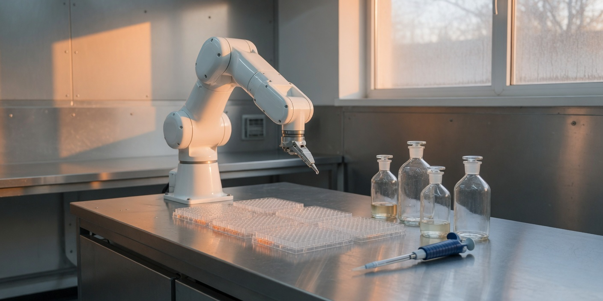

# speed-of-pipetting

The validation loop is still stuck at the speed of pipetting.

This is a one-week capacity model for a lab that sells validated data packages. It is not a wet-lab protocol. Seven synthetic plates go through three policies on the same robot minutes, technician minutes, and reagent prices. A plate is reserved in full before it starts. A failure stops the plate and frees the unrun tail. Prices are illustrative. The run is offline and deterministic.

**human-loop** has no robot. Handler minutes and judgment minutes both come from technicians. A recoverable failure is kept as a training record, and one corrected rerun is spent if the week still has room.

**churn-on-fail** uses the robot for handler steps. A failed plate is terminal: no training record, no rerun, no package. The reagent is already spent.

**owned-lab** uses the same robot, keeps every failure as a training record, and spends one corrected rerun when the failure class is on the recoverable list and the proposal says the rerun passes. A class outside that list is recorded and not rerun, even if the proposal asked for one.

## Run

From the repo root. Python 3.11 or newer. No install and no API key.

```bash
python3 -m speed_of_pipetting fixtures/week.json
python3 -m speed_of_pipetting --verbose fixtures/week.json
python3 -m speed_of_pipetting --json fixtures/week.json
python3 -m unittest discover -s tests -v
```

## Result

```
week 2026-W44  robot 1000 min  tech 400 min  jobs 7

policy         shipped  recovered  records  churned  deferred  reagent USD  revenue USD  margin USD
-------------  -------  ---------  -------  -------  --------  -----------  -----------  ----------
human-loop           2          0        1        0         4         1650         3800        2150
churn-on-fail        3          0        0        4         0         4750         6000        1250
owned-lab            5          2        3        0         1         5750        12500        6750

human-loop ships 2 packages (0 recovered) on margin USD 2150; churn-on-fail ships 3 packages (0 recovered) on margin USD 1250; owned-lab ships 5 packages (2 recovered) on margin USD 6750.
```

Automation that throws away a failed plate ships 3 packages and keeps a margin of 1250. The slower human loop ships only 2, but it spends less reagent and keeps a margin of 2150. The owned lab ships 5, two of them recovered, keeps 3 training records, and finishes at a margin of 6750. One non-recoverable failure (`wrong-reagent-lot` on screen-c) is recorded and not rerun. One recoverable plate (screen-f) never starts, because the reruns used the robot time.

| Policy | What it keeps | Shipped | Illustrative margin |
|---|---|---|---|
| human-loop | failures, if a rerun still fits | 2/7 | 2150 |
| churn-on-fail | nothing from a failed plate | 3/7 | 1250 |
| owned-lab | failures, plus one corrected rerun | 5/7 | 6750 |

## Fixture shape

`recoverable` is the lab's list. A step outcome is the first pass. `"rerun": "pass"` means the lab already knows the correction. It does not roll the plate again.

```json
{"name": "uncap", "kind": "judgment", "minutes": 30, "outcome": "fail", "failure": "plate-looks-wrong"}
```

`kind` is `handler` or `judgment`. Under `human-loop`, both draw on technician minutes.

## License

MIT
